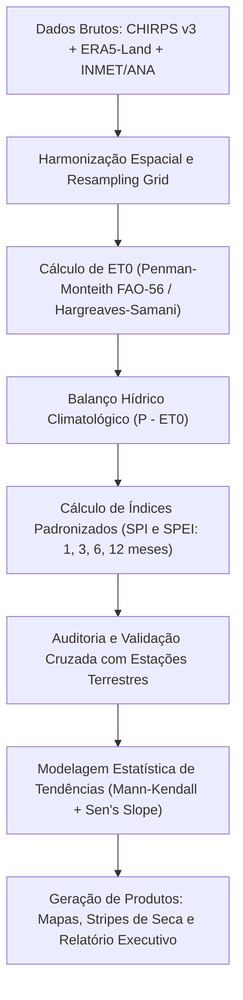

# Plano de Desenvolvimento: Atlas Histórico de Secas e Risco Hídrico do Estado do Rio de Janeiro (1981–2024)

## 1. Visão Geral do Projeto

Este projeto tem como objetivo construir um **Atlas de Risco Hídrico e Dinâmica de Secas Agrícolas e Meteorológicas** para o Estado do Rio de Janeiro, combinando mais de 40 anos de matrizes climáticas de reanálise (**ERA5**) e satélite (**CHIRPS v3**), validados contra a malha observacional de superfície (**INMET e ANA**).

O foco estratégico deste projeto é posicionar o autor no **mercado de Ciência de Dados Ambientais, Risco Climático Corporativo (ESG/TCFD), Agronegócio e Gestão de Recursos Hídricos**, demonstrando capacidade de processamento massivo de dados geoespaciais, rigor estatístico e comunicação executiva de impacto.

---

## 2. Perguntas-Chave que o Projeto Responde

1. **Onde e com que velocidade o déficit hídrico está avançando no território fluminense?**
   - Há avanço da aridez no Norte e Noroeste Fluminense? O Vale do Paraíba está enfrentando primaveras mais secas?
2. **Qual é o histórico de frequência, severidade e duração das secas nas mesorregiões do estado?**
   - Como o Índice Padronizado de Precipitação-Evapotranspiração (**SPEI**) se comportou nas últimas 4 décadas nas escalas de 3, 6 e 12 meses?
3. **Qual foi a anatomia espacial dos maiores desastres de estiagem da história recente?**
   - Como o território fluminense foi impactado pela megasseca histórica de 2014–2015 no Sudeste?
4. **O satélite e a reanálise concordam com a realidade de campo?**
   - Como o balanço hídrico derivado de CHIRPS + ERA5 se alinha aos registros históricos dos pluviômetros do INMET e da ANA?

---

## 3. Matriz de Dados e Variáveis

| Fonte | Variáveis Utilizadas | Resolução Espacial | Resolução Temporal | Papel no Projeto |
| :--- | :--- | :--- | :--- | :--- |
| **CHIRPS v3** | Precipitação ($P$) | $\sim 0,05^\circ$ ($\approx 5,5\text{ km}$) | Diária / Mensal | Base primária de chuva espacializada de alta resolução. |
| **ERA5-Land** | Temperatura média, máxima, mínima ($T$), Ponto de Orvalho ($T_d$), Vento ($u_{10}, v_{10}$), Radiação solar ($SSRD$) | $\sim 0,1^\circ$ ($\approx 9\text{ km}$) | Horária / Diária | Cálculo da Evapotranspiração Potencial ($ET_0$) e balanço de energia. |
| **INMET** | $P$, $T_{max}$, $T_{min}$, $UR$, Vento das estações automáticas e convencionais | Pontual (*in situ*) | Horária / Diária | Controle de qualidade e validação de verdade terrestre (*ground truth*). |
| **ANA (HidroWeb)** | Séries históricas de pluviômetros e postos fluviométricos | Pontual (*in situ*) | Diária | Validação em bacias críticas e correlação com vazão em rios-chave. |

---

## 4. Metodologia Científica e Pipeline Analítico



### 4.1. Harmonização e Pré-Processamento
- Recorte para os limites político-administrativos do Estado do Rio de Janeiro com *buffer* de segurança de 15 km.
- Reprojeção e reamostragem bilinear/bicúbica da grade do ERA5 para coincidir com a grade mais fina do CHIRPS v3 ($\sim 0,05^\circ$).
- Construção de matrizes analíticas em formato `.parquet` particionadas para garantir consultas em milissegundos.

### 4.2. Estimativa da Evapotranspiração Potencial ($ET_0$)
- Cálculo primário via método de **Penman-Monteith (FAO-56)** a partir das variáveis atmosféricas do ERA5.
- (Opcional para comparação metodológica): Estimativa por **Hargreaves-Samani** baseada em amplitude térmica diária ($T_{max} - T_{min}$).

### 4.3. Cálculo do Balanço Hídrico e Índices de Seca
- Cálculo do balanço hídrico simples $D = P - ET_0$ para cada pixel e mês da série temporal (1981–2024).
- Ajuste de distribuições estatísticas aos dados acumulados em diferentes escalas temporais:
  - **SPI** (apenas precipitação - CHIRPS): distribuição Gamma ou Pearson Tipo III.
  - **SPEI** (precipitação - evapotranspiração): distribuição Log-Logística de 3 parâmetros.
- Escalas temporais padronizadas:
  - **SPEI-3:** Secas agrícolas de curto prazo (estresse na safra e pastagens).
  - **SPEI-6:** Secas sazonais e impacto em reservatórios menores.
  - **SPEI-12:** Secas hidrológicas plurianuais e impacto em grandes bacias (ex: Rio Paraíba do Sul).

### 4.4. Análise de Tendência de Longo Prazo
- Aplicação do teste de **Mann-Kendall com pré-branqueamento (TFPW)** para neutralizar a autocorrelação serial nas séries de índices hídricos.
- Estimativa da taxa de mudança decenal pelo **Sen's Slope**.
- Mapeamento espacial das regiões onde a aridez está se intensificando com significância estatística ($p < 0,05$).

---

## 5. Entregáveis do Projeto (O que compõe o Portfólio)

1. **Repositório GitHub Estruturado e Reprodutível:**
   - Scripts modulares em R ou Python documentados com cabeçalho metodológico.
   - Arquitetura limpa (`data/`, `R/`, `output/figures/`, `reports/`).
2. **Conjunto Visual de Alto Impacto (Imagens para LinkedIn):**
   - **Mapa 1 (Atlas de Tendências):** Tendência de 40 anos do SPEI-12 pixel a pixel, destacando os polos de aridização no estado.
   - **Mapa 2 (Anatomia de um Evento Extremo):** Painel espacial da grande estiagem de 2014–2015 mês a mês no RJ.
   - **Gráfico 3 (Climate Stripes de Seca):** Faixas temporais (estilo *Warming Stripes*, mas em tons de marrom/amarelo para seca e azul/verde para umidade) para os principais polos agropecuários fluminenses (ex: Campos dos Goytacazes, Itaperuna, Cantagalo, Piraí).
3. **Whitepaper / Relatório Técnico em Quarto:**
   - Relatório em HTML/PDF elegante para download, apresentando a metodologia, os resultados numéricos e recomendações de adaptação climática.
4. **Post Magnético para o LinkedIn:**
   - Copywriting estruturado com gancho forte, carrossel visual e links para o código no GitHub.

---

## 6. Roteiro Sugerido para a Postagem no LinkedIn

```markdown
🚨 Risco climático além das capitais: o que 40 anos de dados de satélite e reanálise revelam sobre a aridez no Estado do Rio de Janeiro?

Quando se fala no clima do Rio, a maioria das pessoas pensa em praias quentes ou nas chuvas de verão da Região Serrana. 

Mas e o interior fluminense? Como a combinação de calor crescente e déficit de chuvas está impactando o Norte, o Noroeste e o Vale do Paraíba?

Para responder a isso com rigor científico, desenvolvi o "Atlas Histórico de Secas e Risco Hídrico do RJ (1981–2024)", integrando:
🔹 CHIRPS v3 (precipitação espacializada de alta resolução);
🔹 ERA5-Land (variáveis atmosféricas para cálculo da evapotranspiração de Penman-Monteith);
🔹 Validação terrestre com as redes de superfície do INMET e da ANA.

📊 Alguns achados da análise:
1. O Índice SPEI-12 indica que a frequência de secas severas aumentou significativamente em [Região X].
2. A seca histórica de 2014–2015 impôs um déficit hídrico de mais de [Y] mm na Bacia do Rio Paraíba do Sul.
3. A divergência entre satélite e estações de superfície reforça a importância da validação cruzada em relevo acidentado.

Todo o pipeline de processamento em larga escala, código em [R/Python] e os mapas de alta resolução estão documentados e abertos no meu GitHub:
🔗 [Link do Repositório]

Como a sua organização está quantificando o risco físico climático e a segurança hídrica nas suas operações? Vamos conversar nos comentários! 👇

#DataScience #Climatologia #Geoprocessamento #RStats #Python #ESG #RiscoClimatico #ERA5 #RecursosHidricos #Bioestatistica
```

---

## 7. Próximos Passos Imediatos de Execução

- [ ] **Etapa 1:** Definir a linguagem primária do pipeline analítico (R com `terra`, `sf`, `SPEI` e `ggplot2` ou Python com `xarray`, `geopandas`, `rasterio`).
- [ ] **Etapa 2:** Inspecionar o formato atual dos seus arquivos do ERA5 e CHIRPS (NetCDF, GeoTIFF, coordenadas e variáveis exatas).
- [ ] **Etapa 3:** Criar o script piloto de cálculo de $ET_0$ e extração da série temporal de um pixel de teste.
